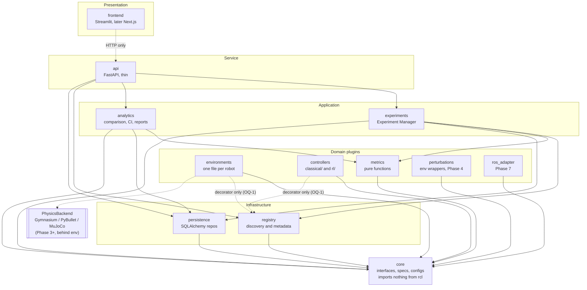

# Component Architecture

Source: `project_context.md` §3-4. Arrows mean "imports / depends on". Layers depend downward only; `import-linter` enforces this.

## Diagram

Dashed edges are special. The frontend edge is a network call, not an import. The `ENV/CTL -> registry` edges are provisional resolution (a) of the open question in `docs/OPEN_QUESTIONS.md`; if resolution (b) wins (decorator lives in `core`), they disappear. `analytics -> metrics/persistence/core` is not stated in §4; it is inferred and encoded in the layers contract (see end of file). Environments and controllers are discovered by the registry at runtime (package scan), not imported by it.

## Responsibilities

**core** holds only interfaces and types: `BaseEnvironment`, `BaseController`, `EnvSpec`, `TaskSpec`, `EpisodeTrajectory`, `TrainConfig`, the Pydantic experiment config. It has no heavy dependencies and no project imports, so every other module can depend on it safely.

**registry** stores environment and controller entries behind `@register_environment` / `@register_controller`, discovers them by `pkgutil` package scanning, and returns metadata plus a Pydantic parameter schema per entry. It filters controller/environment compatibility from declared action-space types. Nothing else knows concrete names.

**environments** contain one file per robot (CartPole continuous/discrete, Pendulum balance/swing-up, later balance bot, arm). Each file implements `BaseEnvironment`, self-registers, and exposes `get_state`, `get_task_spec`, and optionally `get_linearization`. They import only `core` (plus the registry decorator, see above).

**controllers** hold `classical/` (PID, LQR, later MPC) and `rl/` (thin SB3 wrappers). Each file implements `BaseController`, declares `requires_training` and supported action spaces, and self-registers. They never see a concrete robot.

**experiments** is the Experiment Manager: validates the config, seeds everything explicitly, resolves env/controller via the registry, runs train and evaluate, calls metrics, saves artifacts and run records through persistence, and records seed, config, and library/code versions. It is the only place that wires components together.

**metrics** is the Metrics Engine: pure functions over an `EpisodeTrajectory`, each with a written definition in `rcl/metrics/DEFINITIONS.md`. No I/O, no global state.

**analytics** performs cross-run work: comparison tables, aggregation over seeds with confidence intervals, plots and Markdown/HTML reports. It reads results through persistence and recomputes nothing the metrics module already defines.

**persistence** provides SQLAlchemy models and repositories (SQLite now, PostgreSQL later by config). It stores the experiment catalog, run status, metric results, and artifact references; see `data-model.md`.

**api** is a thin FastAPI layer: registry listing, create/run/get experiment, and analytics queries. Long jobs are handed to a background worker and polled by status. It contains no domain logic.

**frontend** renders dropdowns, parameter forms and plots purely from API/registry metadata, and has zero environment-specific logic. Streamlit now; Next.js in Phase 5 consuming the same API.

## Where later modules slot in

- **perturbations (Phase 4):** env wrappers (`gymnasium.Wrapper` over `BaseEnvironment`) for disturbances, sensor noise, wind, mass variation. They import `core` only and are selected through the experiment config (a `perturbations:` list resolved by the experiment manager), so no environment or controller changes. Robustness metrics (failure count, recovery time) are added to `metrics`.
- **ros_adapter (Phase 7):** another `BaseEnvironment` implementation that bridges to ROS2 hardware. It lives beside `environments`, imports `core` only, and registers like any robot, so controllers and the manager are unchanged. Policy export and a safety-limits layer sit in this package.
- **PhysicsBackend (Phase 3+):** an interface (in `core`) that an environment uses internally to step a simulation; Gymnasium-native, PyBullet, and later MuJoCo implement it. It is chosen via `EnvMetadata.physics_backend`, invisible to controllers, and is the bottom of the layer stack in principle 6.

## Layering contract note

`pyproject.toml` layers: `analytics` sits in its own layer above `persistence | metrics` (which stay independent of each other), so `analytics -> persistence/metrics/core` is allowed by the layers contract, matching the diagram. Nothing in `experiments` or `api` may be imported by `analytics`.
