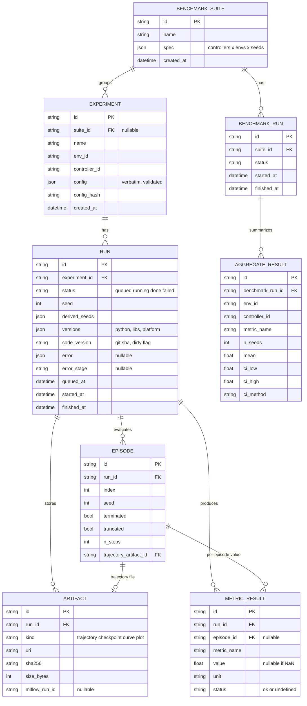

# Data Model

SQLAlchemy models (SQLite now, PostgreSQL later by connection URL only; Alembic migrations). Source: project_context §5.4, §6.6, principle 5.

## ER diagram

## Notes on entities

- **Experiment** is the reusable definition (config), **Run** is one execution. Phase 1 creates exactly one Run per Experiment. A multi-seed benchmark creates one Experiment per (controller, env, seed) cell, or one Run per seed under a shared Experiment. The latter is preferred, because aggregation then needs only a `GROUP BY experiment_id`. Decision to confirm in the registry/benchmark ADR.
- **EpisodeTrajectory** is not a table. The DB holds an `EPISODE` row with a pointer to the trajectory artifact (see below).
- **METRIC_RESULT** has one row per (run, episode, metric_name). Rows with `episode_id` NULL hold run-level scalars (e.g. final training return). `value` is NULL and `status = undefined` when a metric is not defined for that episode (see `rcl/metrics/DEFINITIONS.md`).
- **AGGREGATE_RESULT** is a cache of cross-seed statistics (mean, CI) that `analytics` can always recompute. Introduced in Phase 2; Phase 1 does not need it.
- **BENCHMARK_SUITE / BENCHMARK_RUN** appear in Phase 2. The suite stores the grid; the same seeds, episode count, initial-state distribution and time limit apply to every cell (§6.8). Phase 4 robustness suites reuse this with a `perturbations` list inside `spec`.

## Reproducibility fields

A run is reproducible if `RUN` and its `EXPERIMENT` contain:

| Field | Where | Content |
|---|---|---|
| seed | `RUN.seed`, `config.experiment.seed` | root seed |
| derived seeds | `RUN.derived_seeds` | env / train / eval seeds from `SeedSequence` |
| config verbatim | `EXPERIMENT.config` | the validated Pydantic dump, stored as submitted, plus `config_hash` (sha256 of canonical JSON) |
| library versions | `RUN.versions` | python, numpy, gymnasium, stable-baselines3, torch, rcl, platform; from `importlib.metadata` |
| code version | `RUN.code_version` | git commit sha and whether the tree was dirty |

Registry entry versions (env/controller `version` metadata) are recorded inside `RUN.versions`. If the tree was dirty, the diff is not stored; the flag only warns that reproduction may differ.

## DB versus MLflow (§6.6)

| Concern | Database | MLflow |
|---|---|---|
| Experiment catalog, status, config, seeds, versions | yes (source of truth) | no |
| Per-episode and per-run metric values | yes | optional mirror |
| Benchmark suites and aggregates, comparisons | yes | no |
| Training curves, loss/reward time series | pointer only | yes |
| Model checkpoints, large run artifacts | pointer (`ARTIFACT.uri`, `mlflow_run_id`) | yes (Phase 2+) |

Rule: the DB can answer every comparison query without MLflow running. MLflow is an optional tracking sink (Phase 2); `ARTIFACT.mlflow_run_id` links the two. Checkpoints and datasets are never committed to git (CLAUDE.md rule 7).

## Trajectories as artifacts

- An `EpisodeTrajectory` (time, states, observations, actions, rewards, flags, task spec snapshot) is written once per episode to the artifact store as a compressed `.npz` (arrays only, no pickle), at `artifacts/<run_id>/episodes/<index>.npz`. The store is a local directory now; an object-store URI later, with the same `ARTIFACT.uri` column.
- Rationale: trajectories are large and read in bulk, so they stay out of the DB. Metrics are pure functions of the trajectory, so they can be recomputed from the artifact if a definition changes; `sha256` guards integrity.
- Directory `artifacts/` is git-ignored.
