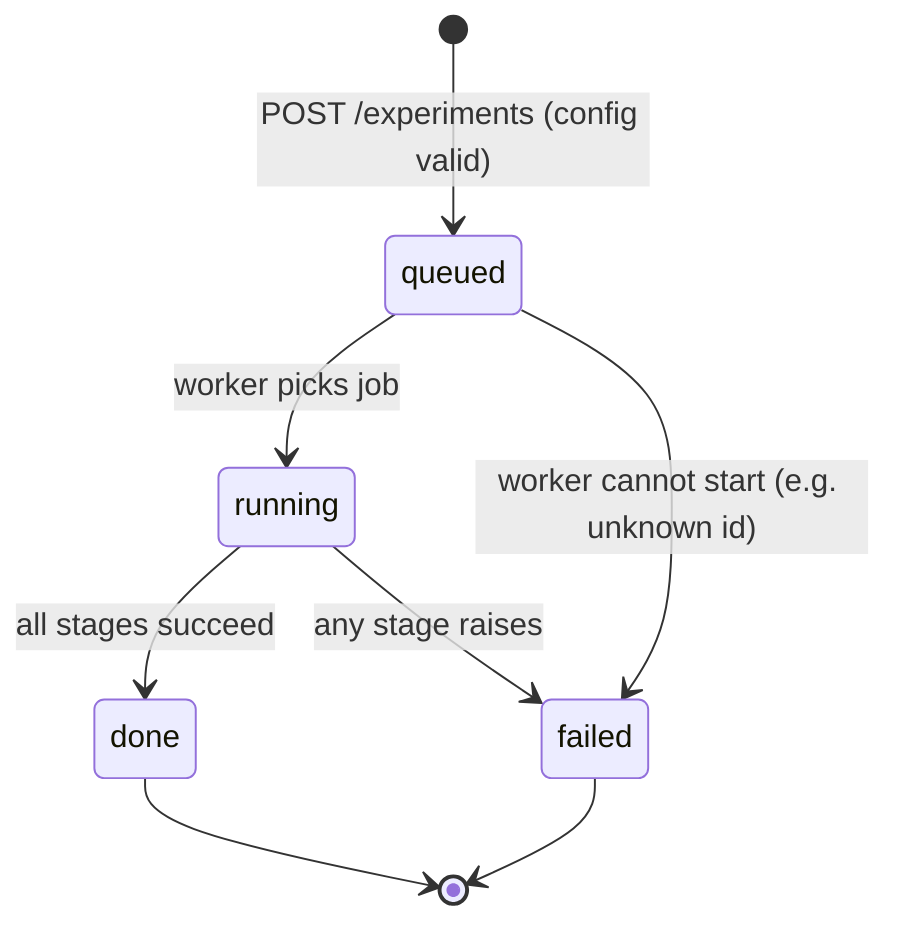
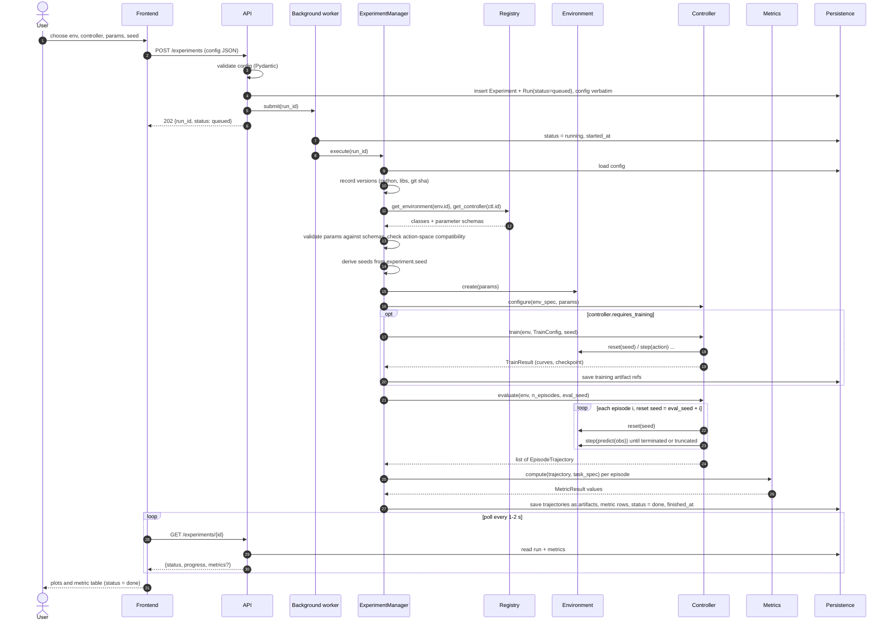

# Sequence: Run Experiment

Covers `POST /experiments` through result display. Design rules: project_context §5.4 (config), §6.8-6.9 (fairness, background jobs), principle 5 (reproducibility). Endpoint names follow Phase 1: `/experiments`, `/experiments/{id}`.

## Status states

`failed` rows keep `error` (type, message, traceback) and the stage reached. No automatic retry; a re-run creates a new experiment with the same config and seed.

## Main flow

## Seeding

- One `experiment.seed` is stored in the config. The manager derives independent seeds with `numpy.random.SeedSequence(seed).spawn(...)`: one for env construction, one for training, one for evaluation.
- Evaluation episode `i` resets with `eval_seed + i` (or the i-th spawned child), so every controller in a benchmark sees identical initial states (§6.8).
- No global RNG is used; seeds are passed explicitly to `reset`, `train`, and `evaluate`. The derived seeds are written to the Run row.

## Failure path

Rules:
- Config or registry-lookup errors are caught before work starts: `POST` returns 422 and nothing is queued. Errors discovered inside the worker (unknown id, schema mismatch) produce `queued -> failed`.
- The worker never crashes on one job; every exception is converted to a `failed` row, so polling always terminates.
- Partial artifacts written before the failure are kept and linked to the Run for debugging.
- Server restart while `running`: on startup, runs left in `running` or `queued` are marked `failed` (reason `interrupted`) in the in-process worker design; a real queue replaces this later.
- A single episode that hits the time limit is `truncated`, not a failure. Only exceptions fail a run.
