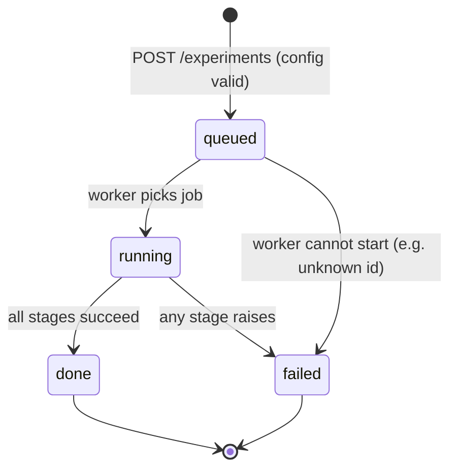
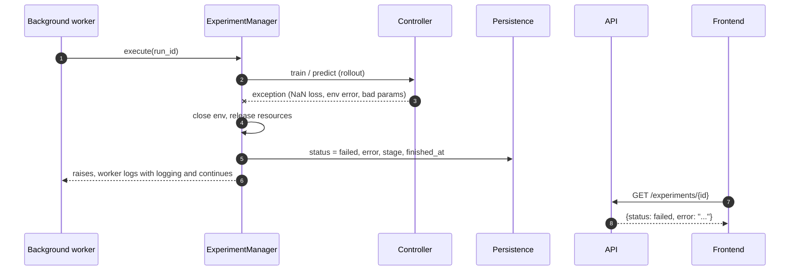

# Sequence: Run Experiment

Covers `POST /experiments` through result display. Design rules: project_context §5.4 (config), §6.8-6.9 (fairness, background jobs), principle 5 (reproducibility). Endpoint names follow Phase 1: `/experiments`, `/experiments/{id}`.

## Status states



`failed` rows keep `error` (type, message, traceback) and the stage reached. No automatic retry; a re-run adds a new Run to the same Experiment (ADR 0009), with the same config and seed unless overridden.

## Main flow

```mermaid
sequenceDiagram
    autonumber
    actor U as User
    participant FE as Frontend
    participant API as API
    participant W as Background worker
    participant EM as ExperimentManager
    participant REG as Registry
    participant ENV as Environment
    participant CTL as Controller
    participant MET as Metrics
    participant DB as Persistence

    U->>FE: choose env, controller, params, seed
    FE->>API: POST /experiments (config JSON)
    API->>API: validate config (Pydantic)
    API->>DB: insert Experiment + Run(status=queued), config verbatim
    API->>W: submit(run_id)
    API-->>FE: 202 {run_id, status: queued}

    W->>DB: status = running, started_at
    W->>EM: execute(run_id)
    EM->>DB: load config
    EM->>EM: record versions (python, libs, git sha)
    EM->>REG: get("environment", env.id), get("controller", ctl.id)
    REG-->>EM: Entry (cls, metadata, params_model)
    EM->>EM: entry.validate_params(raw) -> resolved params, check action-space compatibility
    EM->>EM: derive seeds from experiment.seed
    EM->>ENV: cls(**validated_params) (evaluation env; training uses env_factory with the same wrapper stack)
    EM->>ENV: get_env_spec(), get_linearization()
    EM->>CTL: cls(), then configure(env_spec, validated_params, linear_model)
    Note over EM,CTL: linear_model is in observation coordinates, None if the env offers none

    opt controller metadata requires_training
        EM->>CTL: train(env_factory, TrainConfig(total_timesteps, seed, n_envs))
        CTL->>ENV: env_factory() x n_envs, then reset(seed) / step(action) ...
        CTL-->>EM: TrainResult (timesteps, curve)
        EM->>CTL: save(checkpoint_dir) (dir created by EM; controller fills it)
        EM->>DB: save training artifact refs
    end

    EM->>EM: rollout(env, controller, n_episodes, eval_seed)
    loop each episode i, reset seed = eval_seed + i
        EM->>ENV: reset(seed)
        EM->>CTL: reset()
        EM->>CTL: predict(obs)
        EM->>ENV: step(action) until terminated (failure), truncated (horizon) or success_hold_steps reached
    end
    Note over EM: rollout() is the single shared evaluation loop (ADR 0013); returns list of EpisodeTrajectory

    EM->>MET: compute(trajectory, task_spec) per episode
    MET-->>EM: MetricResult values
    EM->>DB: save trajectories as artifacts, metric rows, status = done, finished_at

    loop poll every 1-2 s
        FE->>API: GET /experiments/{id}
        API->>DB: read run + metrics
        API-->>FE: {status, progress, metrics?}
    end
    FE-->>U: plots and metric table (status = done)
```

## Seeding

- `config.seed` is the experiment's default root seed; the Run's own `seed` (authoritative, may override it for multi-seed benchmarks) is the one used. The manager derives independent seeds with `numpy.random.SeedSequence(seed).spawn(...)`: one for env construction, one for training, one for evaluation.
- Fairness: for the same run seed every controller gets identical evaluation seeds, and the training environment uses the same wrapper stack as the evaluation environment, except perturbations marked `apply_to: eval` (or `train`).
- Evaluation episode `i` resets with `eval_seed + i` (or the i-th spawned child), so every controller in a benchmark sees identical initial states (§6.8).
- No global RNG is used; seeds are passed explicitly to `reset`, `train`, and `evaluate`. The derived seeds are written to the Run row.
- Evaluation is the experiments-layer function `rollout(env, controller, n_episodes, seed) -> list[EpisodeTrajectory]` (contract only, not yet implemented): it is the only evaluation loop, takes any `BaseController`, resets episode `i` with `seed + i`, calls `predict(obs, deterministic=True)` until `terminated` (task failure), `truncated` (horizon) or `success_hold_steps` consecutive in-tolerance steps (success is not termination; both flags False), calls `controller.reset()` right after `env.reset`, records true states via `env.get_state()` and judges success with the env's `TaskSpec`.

## Failure path



Rules:
- Config or registry-lookup errors are caught before work starts: `POST` returns 422 and nothing is queued. Errors discovered inside the worker (unknown id, schema mismatch) produce `queued -> failed`.
- The worker never crashes on one job; every exception is converted to a `failed` row, so polling always terminates.
- Partial artifacts written before the failure are kept and linked to the Run for debugging.
- Server restart while `running`: on startup, runs left in `running` or `queued` are marked `failed` (reason `interrupted`) in the in-process worker design; a real queue replaces this later.
- A single episode that hits the time limit is `truncated`, not a failure. Only exceptions fail a run.
