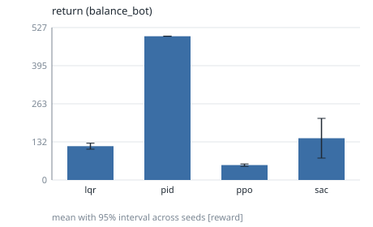
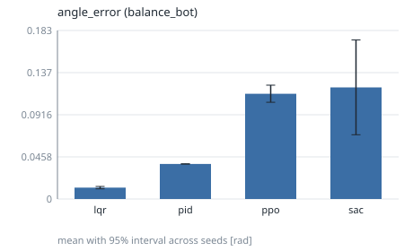
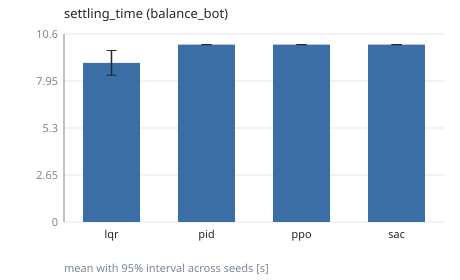
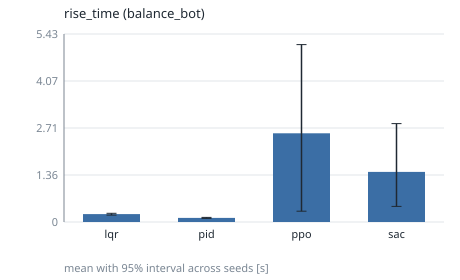
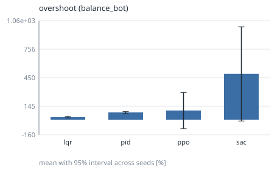
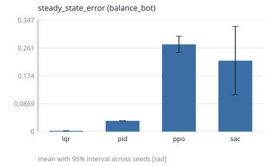
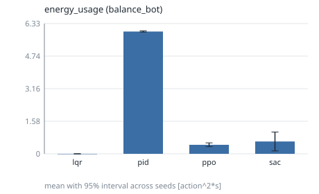
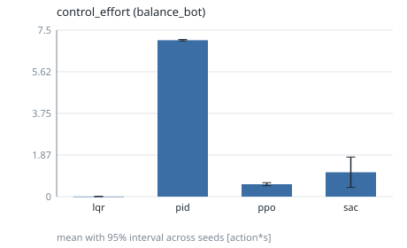

# phase3-balance-bot

## Setup

- Environments: balance_bot
- Controllers: pid, lqr, ppo, sac
- Seeds (5): 0, 1, 2, 3, 4
- Evaluation episodes per run: 5
- Training budget (RL controllers): 10000 timesteps

## Environment: balance_bot

### return

Undiscounted sum of rewards over the episode. (higher is better; interval: t.)

| controller | mean | 95% interval | seeds (valid/total) | unit | notes |
|---|---|---|---|---|---|
| lqr | 116.8 | [106.5, 127.1] | 5/5 | reward |  |
| pid | 496.8 | [496.7, 496.8] | 5/5 | reward |  |
| ppo | 51.4 | [47.22, 55.59] | 5/5 | reward |  |
| sac | 144.2 | [75.57, 212.8] | 5/5 | reward |  |

### angle_error

RMS distance of the controlled output from its reference. (lower is better; interval: t.)

| controller | mean | 95% interval | seeds (valid/total) | unit | notes |
|---|---|---|---|---|---|
| lqr | 0.0124 | [0.01114, 0.01366] | 5/5 | rad |  |
| pid | 0.03806 | [0.03796, 0.03815] | 5/5 | rad |  |
| ppo | 0.1144 | [0.1051, 0.1237] | 5/5 | rad |  |
| sac | 0.1213 | [0.06983, 0.1728] | 5/5 | rad |  |

### settling_time

Time until the error stays within 2% of the step size (censored: T_max). (lower is better; interval: bootstrap.)

| controller | mean | 95% interval | seeds (valid/total) | unit | notes |
|---|---|---|---|---|---|
| lqr | 8.973 | [8.278, 9.668] | 5/5 | s | 5 censored |
| pid | 10 | [10, 10] | 5/5 | s | 5 censored |
| ppo | 10 | [10, 10] | 5/5 | s | 5 censored |
| sac | 10 | [10, 10] | 5/5 | s | 5 censored |

### rise_time

Time from 10% to 90% of the commanded step. (lower is better; interval: bootstrap.)

| controller | mean | 95% interval | seeds (valid/total) | unit | notes |
|---|---|---|---|---|---|
| lqr | 0.2266 | [0.1979, 0.252] | 5/5 | s |  |
| pid | 0.1178 | [0.1025, 0.1335] | 5/5 | s |  |
| ppo | 2.559 | [0.3104, 5.119] | 5/5 | s | 2 censored |
| sac | 1.445 | [0.4493, 2.84] | 5/5 | s | 1 censored |

### overshoot

Percent of the step size beyond the setpoint. (lower is better; interval: t.)

| controller | mean | 95% interval | seeds (valid/total) | unit | notes |
|---|---|---|---|---|---|
| lqr | 28.96 | [19.51, 38.42] | 5/5 | % |  |
| pid | 79.09 | [69.59, 88.58] | 5/5 | % |  |
| ppo | 98.8 | [-94.83, 292.4] | 5/5 | % |  |
| sac | 491.3 | [-13.08, 995.6] | 5/5 | % |  |

### steady_state_error

Mean error over the final 10% of the episode. (lower is better; interval: t.)

| controller | mean | 95% interval | seeds (valid/total) | unit | notes |
|---|---|---|---|---|---|
| lqr | 0.002357 | [0.001984, 0.002729] | 5/5 | rad |  |
| pid | 0.03361 | [0.03349, 0.03373] | 5/5 | rad |  |
| ppo | 0.2721 | [0.2469, 0.2973] | 5/5 | rad | 5 censored |
| sac | 0.2212 | [0.1146, 0.3278] | 5/5 | rad | 5 censored |

### energy_usage

Actuation energy proxy: sum of squared action norm times dt. (lower is better; interval: t.)

| controller | mean | 95% interval | seeds (valid/total) | unit | notes |
|---|---|---|---|---|---|
| lqr | 5.56e-05 | [3.501e-05, 7.62e-05] | 5/5 | action^2*s |  |
| pid | 5.939 | [5.911, 5.968] | 5/5 | action^2*s |  |
| ppo | 0.4385 | [0.3465, 0.5306] | 5/5 | action^2*s |  |
| sac | 0.6003 | [0.1424, 1.058] | 5/5 | action^2*s |  |

### control_effort

Time-integrated action magnitude. (lower is better; interval: t.)

| controller | mean | 95% interval | seeds (valid/total) | unit | notes |
|---|---|---|---|---|---|
| lqr | 0.005005 | [0.003796, 0.006214] | 5/5 | action*s |  |
| pid | 7.044 | [7.013, 7.075] | 5/5 | action*s |  |
| ppo | 0.5583 | [0.4889, 0.6277] | 5/5 | action*s |  |
| sac | 1.099 | [0.4155, 1.782] | 5/5 | action*s |  |

## Notes

- Intervals are two-sided 95% across seeds (the seed is the unit of replication): Student t, or a seeded percentile bootstrap where the metric table says `bootstrap`.
- `censored` counts runs whose value is a bound (for example never settled); they are included in the mean.
- Rows marked `<5 seeds` have wide intervals: no significance claim should be made from them.
