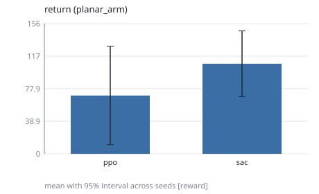
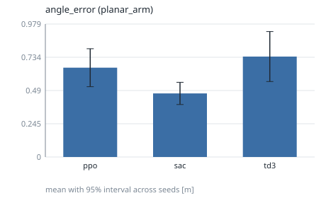
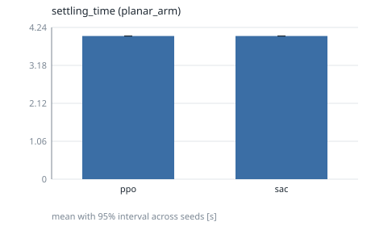
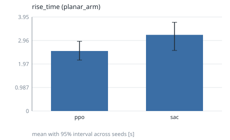
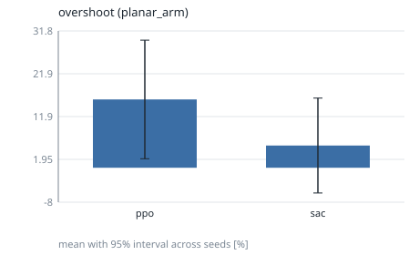
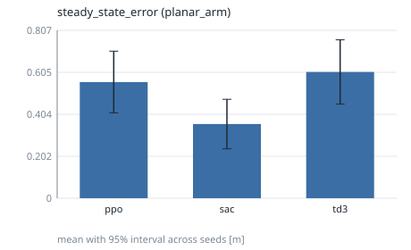
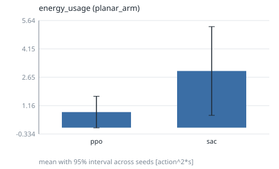
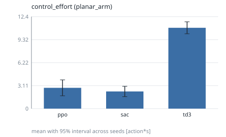

# phase3-planar-arm

## Setup

- Environments: planar_arm
- Controllers: ppo, sac
- Seeds (5): 0, 1, 2, 3, 4
- Evaluation episodes per run: 5
- Training budget (RL controllers): 10000 timesteps

## Environment: planar_arm

### return

Undiscounted sum of rewards over the episode. (higher is better; interval: t.)

| controller | mean | 95% interval | seeds (valid/total) | unit | notes |
|---|---|---|---|---|---|
| ppo | 69.72 | [10.91, 128.5] | 5/5 | reward |  |
| sac | 107.7 | [68.48, 147] | 5/5 | reward |  |

### angle_error

RMS distance of the controlled output from its reference. (lower is better; interval: t.)

| controller | mean | 95% interval | seeds (valid/total) | unit | notes |
|---|---|---|---|---|---|
| ppo | 0.6834 | [0.5227, 0.8441] | 5/5 | m |  |
| sac | 0.5738 | [0.4307, 0.7169] | 5/5 | m |  |

### settling_time

Time until the error stays within 2% of the step size (censored: T_max). (lower is better; interval: bootstrap.)

| controller | mean | 95% interval | seeds (valid/total) | unit | notes |
|---|---|---|---|---|---|
| ppo | 4 | [4, 4] | 5/5 | s | 5 censored |
| sac | 4 | [4, 4] | 5/5 | s | 5 censored |

### rise_time

Time from 10% to 90% of the commanded step. (lower is better; interval: bootstrap.)

| controller | mean | 95% interval | seeds (valid/total) | unit | notes |
|---|---|---|---|---|---|
| ppo | 2.52 | [2.14, 2.927] | 5/5 | s | 5 censored |
| sac | 3.2 | [2.543, 3.725] | 5/5 | s | 5 censored |

### overshoot

Percent of the step size beyond the setpoint. (lower is better; interval: t.)

| controller | mean | 95% interval | seeds (valid/total) | unit | notes |
|---|---|---|---|---|---|
| ppo | 15.88 | [2.088, 29.67] | 5/5 | % |  |
| sac | 5.163 | [-5.87, 16.2] | 5/5 | % |  |

### steady_state_error

Mean error over the final 10% of the episode. (lower is better; interval: t.)

| controller | mean | 95% interval | seeds (valid/total) | unit | notes |
|---|---|---|---|---|---|
| ppo | 0.575 | [0.4376, 0.7124] | 5/5 | m |  |
| sac | 0.5096 | [0.2972, 0.7219] | 5/5 | m |  |

### energy_usage

Actuation energy proxy: sum of squared action norm times dt. (lower is better; interval: t.)

| controller | mean | 95% interval | seeds (valid/total) | unit | notes |
|---|---|---|---|---|---|
| ppo | 0.8191 | [-0.01408, 1.652] | 5/5 | action^2*s |  |
| sac | 2.985 | [0.6484, 5.322] | 5/5 | action^2*s |  |

### control_effort

Time-integrated action magnitude. (lower is better; interval: t.)

| controller | mean | 95% interval | seeds (valid/total) | unit | notes |
|---|---|---|---|---|---|
| ppo | 1.563 | [0.6856, 2.44] | 5/5 | action*s |  |
| sac | 2.009 | [0.652, 3.365] | 5/5 | action*s |  |

## Notes

- Intervals are two-sided 95% across seeds (the seed is the unit of replication): Student t, or a seeded percentile bootstrap where the metric table says `bootstrap`.
- `censored` counts runs whose value is a bound (for example never settled); they are included in the mean.
- Rows marked `<5 seeds` have wide intervals: no significance claim should be made from them.
