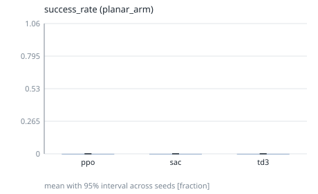
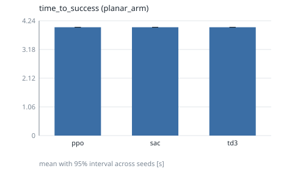

# phase3-planar-arm-30k

## Setup

- Environments: planar_arm
- Controllers: ppo, sac, td3
- Seeds (5): 0, 1, 2, 3, 4
- Evaluation episodes per run: 5
- Training budget (RL controllers): 30000 timesteps

## Environment: planar_arm

> Headline metrics (success_rate, time_to_success) say whether the task was achieved. The reward sum (`return`) is a training signal, not the headline metric: success ends an episode early, so a controller that succeeds can score a lower return than one that never does.

### success_rate

Fraction of episodes in which the task tolerance was held (headline). (higher is better; interval: bootstrap.)

| controller | mean | 95% interval | seeds (valid/total) | unit | notes |
|---|---|---|---|---|---|
| ppo | 0 | [0, 0] | 5/5 | fraction |  |
| sac | 0 | [0, 0] | 5/5 | fraction |  |
| td3 | 0 | [0, 0] | 5/5 | fraction |  |

### time_to_success

Time at which the successful in-tolerance streak began (censored: T_max). (lower is better; interval: bootstrap.)

| controller | mean | 95% interval | seeds (valid/total) | unit | notes |
|---|---|---|---|---|---|
| ppo | 4 | [4, 4] | 5/5 | s | 5 censored |
| sac | 4 | [4, 4] | 5/5 | s | 5 censored |
| td3 | 4 | [4, 4] | 5/5 | s | 5 censored |

### return

Undiscounted sum of rewards over the episode. (higher is better; interval: t.)

| controller | mean | 95% interval | seeds (valid/total) | unit | notes |
|---|---|---|---|---|---|
| ppo | 83.14 | [42.66, 123.6] | 5/5 | reward |  |
| sac | 140.7 | [120.2, 161.2] | 5/5 | reward |  |
| td3 | 41.74 | [-39.6, 123.1] | 5/5 | reward |  |

### angle_error

RMS distance of the controlled output from its reference. (lower is better; interval: t.)

| controller | mean | 95% interval | seeds (valid/total) | unit | notes |
|---|---|---|---|---|---|
| ppo | 0.6575 | [0.5175, 0.7975] | 5/5 | m |  |
| sac | 0.4683 | [0.3865, 0.5502] | 5/5 | m |  |
| td3 | 0.7396 | [0.5557, 0.9236] | 5/5 | m |  |

### settling_time

Time until the error stays within 2% of the step size (censored: T_max). (lower is better; interval: bootstrap.)

| controller | mean | 95% interval | seeds (valid/total) | unit | notes |
|---|---|---|---|---|---|
| ppo | 4 | [4, 4] | 5/5 | s | 5 censored |
| sac | 4 | [4, 4] | 5/5 | s | 5 censored |
| td3 | 4 | [4, 4] | 5/5 | s | 5 censored |

### rise_time

Time from 10% to 90% of the commanded step. (lower is better; interval: bootstrap.)

| controller | mean | 95% interval | seeds (valid/total) | unit | notes |
|---|---|---|---|---|---|
| ppo | 2.706 | [1.648, 3.543] | 5/5 | s | 4 censored |
| sac | 2.693 | [2.063, 3.215] | 5/5 | s | 5 censored |
| td3 | 1.494 | [0.8121, 2.09] | 5/5 | s | 3 censored |

### overshoot

Percent of the step size beyond the setpoint. (lower is better; interval: t.)

| controller | mean | 95% interval | seeds (valid/total) | unit | notes |
|---|---|---|---|---|---|
| ppo | 26.83 | [-38.19, 91.85] | 5/5 | % |  |
| sac | 8.536 | [-8.566, 25.64] | 5/5 | % |  |
| td3 | 52.93 | [11, 94.85] | 5/5 | % |  |

### steady_state_error

Mean error over the final 10% of the episode. (lower is better; interval: t.)

| controller | mean | 95% interval | seeds (valid/total) | unit | notes |
|---|---|---|---|---|---|
| ppo | 0.5585 | [0.4102, 0.7069] | 5/5 | m |  |
| sac | 0.3566 | [0.2375, 0.4758] | 5/5 | m |  |
| td3 | 0.607 | [0.4526, 0.7614] | 5/5 | m |  |

### energy_usage

Actuation energy proxy: sum of squared action norm times dt. (lower is better; interval: t.)

| controller | mean | 95% interval | seeds (valid/total) | unit | notes |
|---|---|---|---|---|---|
| ppo | 2.458 | [0.7822, 4.134] | 5/5 | action^2*s |  |
| sac | 3.49 | [2.301, 4.679] | 5/5 | action^2*s |  |
| td3 | 30.3 | [26.97, 33.62] | 5/5 | action^2*s |  |

### control_effort

Time-integrated action magnitude. (lower is better; interval: t.)

| controller | mean | 95% interval | seeds (valid/total) | unit | notes |
|---|---|---|---|---|---|
| ppo | 2.812 | [1.735, 3.889] | 5/5 | action*s |  |
| sac | 2.32 | [1.615, 3.024] | 5/5 | action*s |  |
| td3 | 10.92 | [10.12, 11.73] | 5/5 | action*s |  |

## Notes

- Intervals are two-sided 95% across seeds (the seed is the unit of replication): Student t, or a seeded percentile bootstrap where the metric table says `bootstrap`.
- `censored` counts runs whose value is a bound (for example never settled); they are included in the mean.
- Rows marked `<5 seeds` have wide intervals: no significance claim should be made from them.
