# phase4-balance_bot-action_noise

## Setup

- Environments: balance_bot
- Controllers: pid, lqr
- Seeds (5): 0, 1, 2, 3, 4
- Evaluation episodes per run: 5

## Environment: balance_bot

> Headline metrics (success_rate, time_to_success) say whether the task was achieved. The reward sum (`return`) is a training signal, not the headline metric: success ends an episode early, so a controller that succeeds can score a lower return than one that never does.

### success_rate

Fraction of episodes in which the task tolerance was held (headline). (higher is better; interval: bootstrap.)

| controller | mean | 95% interval | seeds (valid/total) | unit | notes |
|---|---|---|---|---|---|
| lqr | 1 | [1, 1] | 5/5 | fraction |  |
| pid | 0 | [0, 0] | 5/5 | fraction |  |

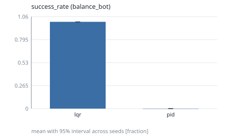

### time_to_success

Time at which the successful in-tolerance streak began (censored: T_max). (lower is better; interval: bootstrap.)

| controller | mean | 95% interval | seeds (valid/total) | unit | notes |
|---|---|---|---|---|---|
| lqr | 0.3576 | [0.2144, 0.48] | 5/5 | s |  |
| pid | 10 | [10, 10] | 5/5 | s | 5 censored |

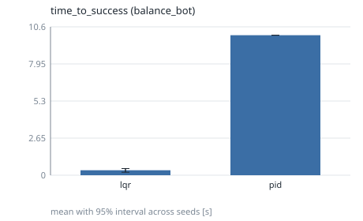

### return

Undiscounted sum of rewards over the episode. (higher is better; interval: t.)

| controller | mean | 95% interval | seeds (valid/total) | unit | notes |
|---|---|---|---|---|---|
| lqr | 116.8 | [106.5, 127.1] | 5/5 | reward |  |
| pid | 496.8 | [496.7, 496.8] | 5/5 | reward |  |

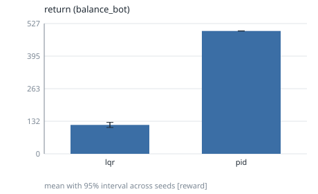

### angle_error

RMS distance of the controlled output from its reference. (lower is better; interval: t.)

| controller | mean | 95% interval | seeds (valid/total) | unit | notes |
|---|---|---|---|---|---|
| lqr | 0.0124 | [0.01114, 0.01366] | 5/5 | rad |  |
| pid | 0.03806 | [0.03796, 0.03815] | 5/5 | rad |  |

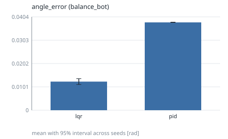

### settling_time

Time until the error stays within 2% of the step size (censored: T_max). (lower is better; interval: bootstrap.)

| controller | mean | 95% interval | seeds (valid/total) | unit | notes |
|---|---|---|---|---|---|
| lqr | 8.973 | [8.278, 9.668] | 5/5 | s | 5 censored |
| pid | 10 | [10, 10] | 5/5 | s | 5 censored |

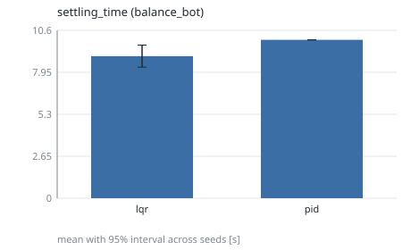

### rise_time

Time from 10% to 90% of the commanded step. (lower is better; interval: bootstrap.)

| controller | mean | 95% interval | seeds (valid/total) | unit | notes |
|---|---|---|---|---|---|
| lqr | 0.2266 | [0.1979, 0.252] | 5/5 | s |  |
| pid | 0.1178 | [0.1025, 0.1335] | 5/5 | s |  |

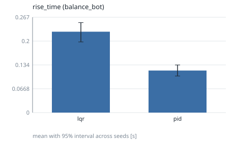

### overshoot

Percent of the step size beyond the setpoint. (lower is better; interval: t.)

| controller | mean | 95% interval | seeds (valid/total) | unit | notes |
|---|---|---|---|---|---|
| lqr | 28.96 | [19.51, 38.42] | 5/5 | % |  |
| pid | 79.09 | [69.59, 88.58] | 5/5 | % |  |

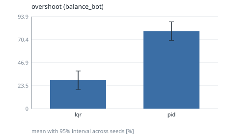

### steady_state_error

Mean error over the final 10% of the episode. (lower is better; interval: t.)

| controller | mean | 95% interval | seeds (valid/total) | unit | notes |
|---|---|---|---|---|---|
| lqr | 0.002357 | [0.001984, 0.002729] | 5/5 | rad |  |
| pid | 0.03361 | [0.03349, 0.03373] | 5/5 | rad |  |

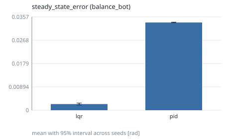

### energy_usage

Actuation energy proxy: sum of squared action norm times dt. (lower is better; interval: t.)

| controller | mean | 95% interval | seeds (valid/total) | unit | notes |
|---|---|---|---|---|---|
| lqr | 5.56e-05 | [3.501e-05, 7.62e-05] | 5/5 | action^2*s |  |
| pid | 5.939 | [5.911, 5.968] | 5/5 | action^2*s |  |

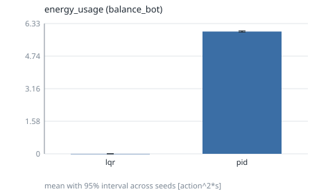

### control_effort

Time-integrated action magnitude. (lower is better; interval: t.)

| controller | mean | 95% interval | seeds (valid/total) | unit | notes |
|---|---|---|---|---|---|
| lqr | 0.005005 | [0.003796, 0.006214] | 5/5 | action*s |  |
| pid | 7.044 | [7.013, 7.075] | 5/5 | action*s |  |

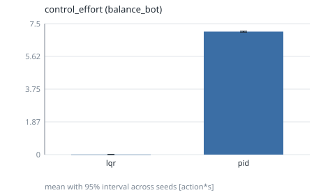

### failure_count

Fraction of episodes that ended in failure (terminated). (lower is better; interval: bootstrap.)

| controller | mean | 95% interval | seeds (valid/total) | unit | notes |
|---|---|---|---|---|---|
| lqr | 0 | [0, 0] | 5/5 | fraction |  |
| pid | 0 | [0, 0] | 5/5 | fraction |  |

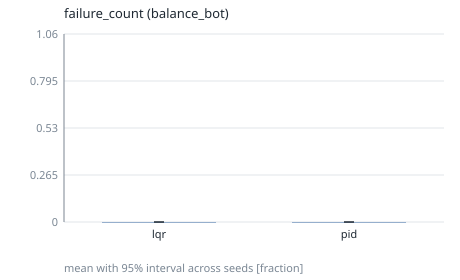

### recovery_time

Time from the first perturbation event to staying in the 2% band. (lower is better; interval: bootstrap.)

| controller | mean | 95% interval | seeds (valid/total) | unit | notes |
|---|---|---|---|---|---|
| lqr | n/a | [n/a, n/a] | 0/5 | s | <5 seeds |
| pid | n/a | [n/a, n/a] | 0/5 | s | <5 seeds |

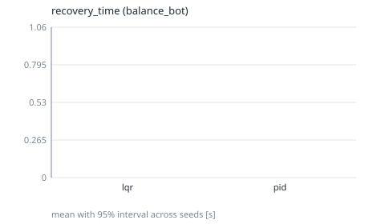

## Notes

- Intervals are two-sided 95% across seeds (the seed is the unit of replication): Student t, or a seeded percentile bootstrap where the metric table says `bootstrap`.
- `censored` counts runs whose value is a bound (for example never settled); they are included in the mean.
- Rows marked `<5 seeds` have wide intervals: no significance claim should be made from them.
