# phase4-cartpole-disturbance

## Setup

- Environments: cartpole
- Controllers: pid, lqr, ppo
- Seeds (5): 0, 1, 2, 3, 4
- Evaluation episodes per run: 5
- Training budget (RL controllers): 20000 timesteps

## Environment: cartpole

> Headline metrics (success_rate, time_to_success) say whether the task was achieved. The reward sum (`return`) is a training signal, not the headline metric: success ends an episode early, so a controller that succeeds can score a lower return than one that never does.

### success_rate

Fraction of episodes in which the task tolerance was held (headline). (higher is better; interval: bootstrap.)

| controller | mean | 95% interval | seeds (valid/total) | unit | notes |
|---|---|---|---|---|---|
| lqr | 1 | [1, 1] | 5/5 | fraction |  |
| pid | 1 | [1, 1] | 5/5 | fraction |  |
| ppo | 0 | [0, 0] | 5/5 | fraction |  |

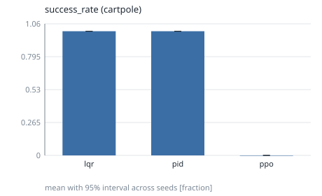

### time_to_success

Time at which the successful in-tolerance streak began (censored: T_max). (lower is better; interval: bootstrap.)

| controller | mean | 95% interval | seeds (valid/total) | unit | notes |
|---|---|---|---|---|---|
| lqr | 0.1856 | [0.1176, 0.2976] | 5/5 | s |  |
| pid | 0.0856 | [0.0704, 0.1032] | 5/5 | s |  |
| ppo | 10 | [10, 10] | 5/5 | s | 5 censored |

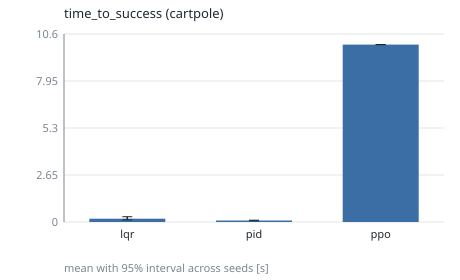

### return

Undiscounted sum of rewards over the episode. (higher is better; interval: t.)

| controller | mean | 95% interval | seeds (valid/total) | unit | notes |
|---|---|---|---|---|---|
| lqr | 108.3 | [100.7, 115.9] | 5/5 | reward |  |
| pid | 103.3 | [102, 104.6] | 5/5 | reward |  |
| ppo | 82.52 | [38.91, 126.1] | 5/5 | reward |  |

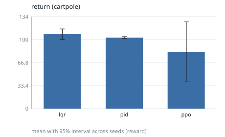

### angle_error

RMS distance of the controlled output from its reference. (lower is better; interval: t.)

| controller | mean | 95% interval | seeds (valid/total) | unit | notes |
|---|---|---|---|---|---|
| lqr | 0.01054 | [0.007952, 0.01314] | 5/5 | rad |  |
| pid | 0.006914 | [0.00546, 0.008367] | 5/5 | rad |  |
| ppo | 0.09134 | [0.07841, 0.1043] | 5/5 | rad |  |

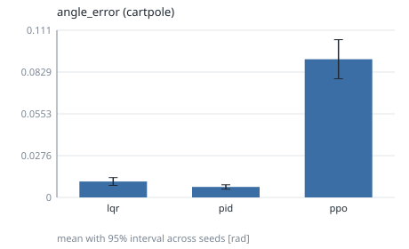

### settling_time

Time until the error stays within 2% of the step size (censored: T_max). (lower is better; interval: bootstrap.)

| controller | mean | 95% interval | seeds (valid/total) | unit | notes |
|---|---|---|---|---|---|
| lqr | 8.982 | [7.633, 10] | 5/5 | s | 5 censored |
| pid | 0.848 | [0.7992, 0.9032] | 5/5 | s |  |
| ppo | 10 | [10, 10] | 5/5 | s | 5 censored |

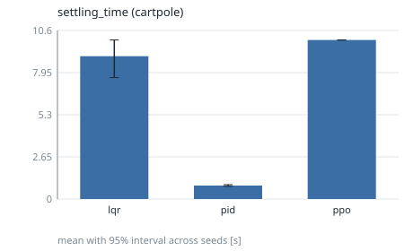

### rise_time

Time from 10% to 90% of the commanded step. (lower is better; interval: bootstrap.)

| controller | mean | 95% interval | seeds (valid/total) | unit | notes |
|---|---|---|---|---|---|
| lqr | n/a | [n/a, n/a] | 0/5 | s | <5 seeds |
| pid | n/a | [n/a, n/a] | 0/5 | s | <5 seeds |
| ppo | n/a | [n/a, n/a] | 0/5 | s | <5 seeds |

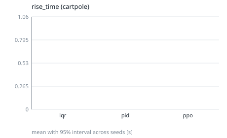

### overshoot

Percent of the step size beyond the setpoint. (lower is better; interval: t.)

| controller | mean | 95% interval | seeds (valid/total) | unit | notes |
|---|---|---|---|---|---|
| lqr | n/a | [n/a, n/a] | 0/5 | % | <5 seeds |
| pid | n/a | [n/a, n/a] | 0/5 | % | <5 seeds |
| ppo | n/a | [n/a, n/a] | 0/5 | % | <5 seeds |

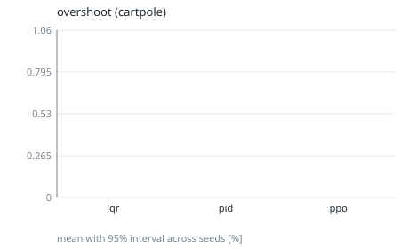

### steady_state_error

Mean error over the final 10% of the episode. (lower is better; interval: t.)

| controller | mean | 95% interval | seeds (valid/total) | unit | notes |
|---|---|---|---|---|---|
| lqr | 0.002393 | [0.001733, 0.003054] | 5/5 | rad |  |
| pid | 1.332e-05 | [1.134e-05, 1.531e-05] | 5/5 | rad |  |
| ppo | 0.1858 | [0.1764, 0.1952] | 5/5 | rad | 5 censored |

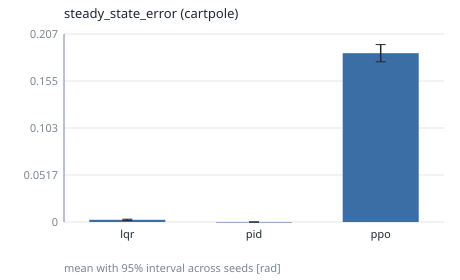

### energy_usage

Actuation energy proxy: sum of squared action norm times dt. (lower is better; interval: t.)

| controller | mean | 95% interval | seeds (valid/total) | unit | notes |
|---|---|---|---|---|---|
| lqr | 0.1019 | [0.03893, 0.1648] | 5/5 | action^2*s |  |
| pid | 0.3479 | [0.2085, 0.4873] | 5/5 | action^2*s |  |
| ppo | 0.9411 | [0.3554, 1.527] | 5/5 | action^2*s |  |

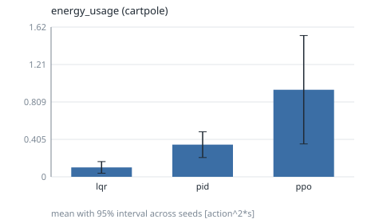

### control_effort

Time-integrated action magnitude. (lower is better; interval: t.)

| controller | mean | 95% interval | seeds (valid/total) | unit | notes |
|---|---|---|---|---|---|
| lqr | 0.2796 | [0.1742, 0.3851] | 5/5 | action*s |  |
| pid | 0.3641 | [0.2833, 0.4448] | 5/5 | action*s |  |
| ppo | 0.9771 | [0.4419, 1.512] | 5/5 | action*s |  |

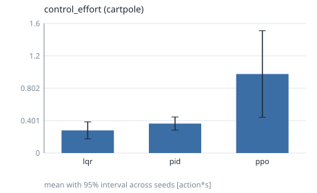

### failure_count

Fraction of episodes that ended in failure (terminated). (lower is better; interval: bootstrap.)

| controller | mean | 95% interval | seeds (valid/total) | unit | notes |
|---|---|---|---|---|---|
| lqr | 0 | [0, 0] | 5/5 | fraction |  |
| pid | 0 | [0, 0] | 5/5 | fraction |  |
| ppo | 1 | [1, 1] | 5/5 | fraction |  |

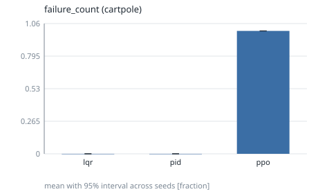

### recovery_time

Time from the first perturbation event to staying in the 2% band. (lower is better; interval: bootstrap.)

| controller | mean | 95% interval | seeds (valid/total) | unit | notes |
|---|---|---|---|---|---|
| lqr | n/a | [n/a, n/a] | 0/5 | s | <5 seeds |
| pid | n/a | [n/a, n/a] | 0/5 | s | <5 seeds |
| ppo | n/a | [n/a, n/a] | 0/5 | s | <5 seeds |

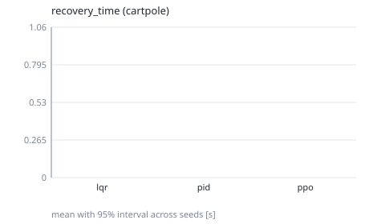

## Notes

- Intervals are two-sided 95% across seeds (the seed is the unit of replication): Student t, or a seeded percentile bootstrap where the metric table says `bootstrap`.
- `censored` counts runs whose value is a bound (for example never settled); they are included in the mean.
- Rows marked `<5 seeds` have wide intervals: no significance claim should be made from them.
